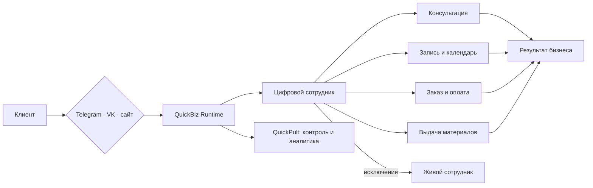

# QuickBiz Automation

### Цифровые сотрудники и цифровые отделы для бизнеса

**QuickPult 1.45.0-rc.1 · рабочий release candidate · контролируемый пилот**

## Что я создаю

Я развиваю **QuickBiz** — инфраструктуру цифровых сотрудников для малого и среднего бизнеса.

Цифровой сотрудник не просто отвечает на сообщения. Он работает по утверждённому процессу: консультирует, квалифицирует обращение, записывает клиента, сопровождает оплату, выдаёт материалы, напоминает о встрече и передаёт исключение человеку вместе с уже собранным контекстом.

> **Каналы — это точки общения. Продукт — это управляемый бизнес-процесс и измеримый результат.**

Стратегическое направление проекта: **цифровой сотрудник → цифровой отдел → корпоративная цифровая инфраструктура**.

## Флагманский продукт

### [QuickPult](https://github.com/leksmustang/QuickPult) — единый Пульт цифровой команды бизнеса

QuickPult объединяет производство, запуск и контроль цифровых сотрудников. Один опубликованный процесс использует общие услуги, цены, правила и действия во всех подключённых каналах, а владелец бизнеса видит диалоги, записи, оплаты, воронку и состояние системы в одном интерфейсе.

### Что уже работает

- управляемый цикл **заявка → производство → тест → согласование → подключение → передача**;
- типовые цифровые роли для консультации, продажи и онлайн-записи;
- конструктор индивидуальных бизнес-процессов с условиями, переходами и действиями;
- настраиваемые кнопки, FAQ, услуги, цены, специалисты и правила передачи человеку;
- единый Runtime для Telegram, ВКонтакте и веб-виджета;
- Пульт диалогов с ручным перехватом и возвратом разговора цифровому сотруднику;
- календарь **день / неделя / месяц**, рабочие графики, фильтры, отмены и напоминания;
- единая отчётность за **месяц / квартал / год** по лидам, записям, продажам и выручке;
- приём чеков, проверка оплаты и синхронный учёт продаж;
- рассылки, уведомления сотрудников и очередь ситуаций, требующих человека;
- Live Operations: состояние каналов, входящих сообщений и ошибок без перезагрузки страницы;
- версионирование опубликованных конфигураций и безопасное обслуживание проектов;
- 201 автоматический тест критической бизнес-логики.

### Состояние каналов

| Канал | Текущее состояние |
|---|---|
| **Telegram** | Работает: webhook, локальный polling, кнопки, вложения и автоматическое восстановление webhook |
| **ВКонтакте** | Работает: Callback API, Long Poll, кнопки и вложения |
| **Веб-виджет** | Работает: общий Runtime, диалоги в Пульте, вложения и ручной перехват |
| **WhatsApp Cloud API** | Адаптер и webhook реализованы; требуется завершающая production E2E-проверка |
| **MAX и Instagram Direct** | Запланированы, но пока не выдаются за готовые интеграции |

## Как устроен продукт

Критические действия остаются детерминированными: цена, свободное время, запись, оплата и статус сделки не придумываются языковой моделью. AI должен улучшать понимание свободного текста и естественность общения, не подменяя проверяемые бизнес-правила.

## Продуктовая модель

| Уровень | Ценность |
|---|---|
| **Базовый** | Один цифровой сотрудник для одного законченного бизнес-процесса |
| **Бизнес** | Цифровой отдел: несколько ролей, общий контекст, маршрутизация задач и расширенная аналитика |
| **Корпоративный** | Несколько процессов или филиалов, CRM/1С/API, расширенные права, аудит, SLA и индивидуальные интеграции |

Сейчас первый уровень уже работает в пилоте. Общий профиль клиента между каналами и полноценная оркестрация нескольких цифровых ролей — следующий архитектурный этап, а не заявленная готовая возможность.

## Ближайшие приоритеты

- единый профиль клиента и продолжение процесса между каналами;
- оркестрация цифрового отдела и контролируемая передача задач между ролями;
- производственные интеграции с CRM, 1С и внешними API;
- подключение MAX, затем Instagram Direct после реальных E2E-проверок;
- гибридный AI-слой и управляемая база знаний;
- production-инфраструктура, резервное копирование, восстановление и SLA.

## Принципы разработки

- **Результат вместо имитации общения.** Диалог должен приводить к записи, оплате, продаже или понятной передаче человеку.
- **Одна логика — несколько каналов.** Мессенджер не должен становиться отдельным бизнес-процессом.
- **Человек работает с исключениями.** Автоматизация снимает повторяющуюся нагрузку, сохраняя контроль владельца.
- **Проверяемые действия важнее красивого текста.** Операции фиксируются событиями и отражаются в аналитике.
- **Честные границы продукта.** Запланированная интеграция не называется готовой до реального end-to-end теста.

## Технологический фокус

`Python` · `FastAPI` · `SQLAlchemy` · `PostgreSQL` · `Telegram Bot API` · `VK API` · `WhatsApp Cloud API` · `Docker` · `Render` · `Webhook` · `Long Poll` · `REST API`

<strong>Предыдущие отраслевые прототипы</strong>

Репозитории [project101](https://github.com/leksmustang/project101), [vk-bot](https://github.com/leksmustang/vk-bot), [Dance_psy_bot](https://github.com/leksmustang/Dance_psy_bot) и [dance-psy_bot](https://github.com/leksmustang/dance-psy_bot) сохраняют ранние сценарии студии танцев, психолога и других направлений. Их прикладной опыт постепенно переносится в единое ядро QuickPult.

---

**Главная разработка:** [QuickPult](https://github.com/leksmustang/QuickPult) · **Продукт:** [quickbizauto.com](https://quickbizauto.com)

